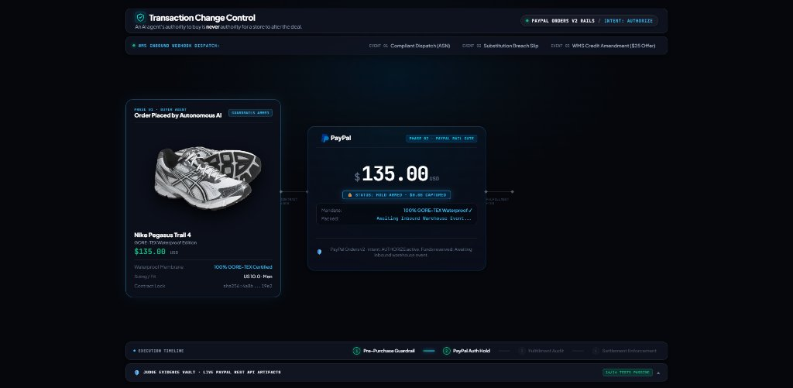
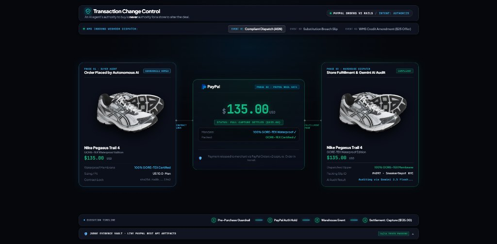
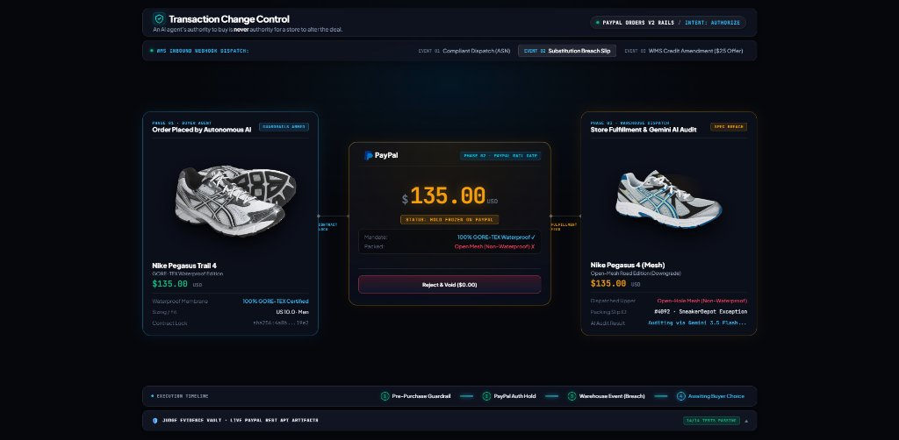
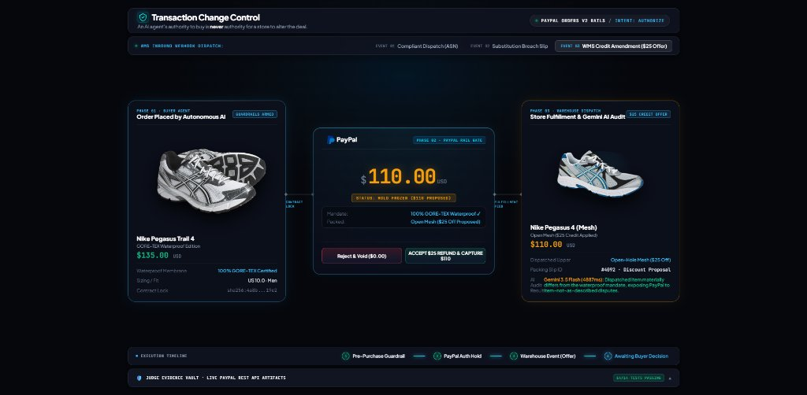
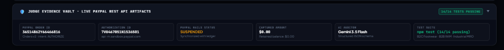

# Transaction Change Control (TCC) on PayPal

> **Fulfillment verification and settlement control for AI shopping agents.**  
> Built for the PayPal AI Hackathon 2026 (`paypalaihackathon.devpost.com`).

---

## Live Sandbox Execution & Correlated Verification

* **Demo Video (YouTube):** [https://youtu.be/twgQyYABZqo](https://youtu.be/twgQyYABZqo)
* **Live Hosted Instance (Render):** [https://tcc-paypal.onrender.com](https://tcc-paypal.onrender.com) *(Hosted on Render Free Tier. If cold, please allow ~25 seconds for initial instance spin-up).*
* **Live PayPal Sandbox Checkout Token:** [https://www.sandbox.paypal.com/checkoutnow?token=3UD04688N2031870R](https://www.sandbox.paypal.com/checkoutnow?token=3UD04688N2031870R) *(Note: Sandbox tokens require interactive payer approval before conversion to authorizations; fresh tokens can be generated via `npm run agent:demo`).*
* **Verified Ledger Authorization Record:** `7VU467051N1536501` (`status: "VOIDED"`, `amount: "135.00 USD"`, verified on `api-m.sandbox.paypal.com`)
* **Payee Merchant ID:** `9QY2YH5UFLKTJ` (`sb-zh47io53822863@business.example.com`)
* **Automated Test Suite:** **14 Passed, 0 Failed** via `npm test` (3 live API integration tests [2 PayPal REST Sandbox + 1 Gemini 3.5 Flash] + 11 deterministic policy & security tests).

### How to Independently Verify the Correlated Mismatch-to-Void Workflow:
To prove the causal link connecting the buyer mandate, warehouse packing slip mismatch, and the resulting PayPal Sandbox void:
```bash
npm run verify:audit
```
This executes `scripts/verify_audit_trail.js`, querying `api-m.sandbox.paypal.com` directly:
1. **Mandate Reference:** Binds PayPal Order `36S14862Y66466816` and Authorization `7VU467051N1536501` to the $135.00 GORE-TEX specification.
2. **Fulfillment Evidence:** Ingests signed packing slip `#4092` attempting an unapproved open-mesh substitution.
3. **Policy Decision:** Triggers `MATERIAL_SPEC_BREACH` and halts capture.
4. **PayPal Ledger Verification:** Live query confirms PayPal Authorization `7VU467051N1536501` is `VOIDED` with $0.00 captured.

> **Note on PayPal Orders v2 Sandbox Evaluation & Strict Financial Rails:**
> 1. **Payer Approval Boundary:** In PayPal sandbox, creating an order with `intent: AUTHORIZE` generates an unapproved order token (`npm run agent:demo` / `npm run test:paypal:live`). Because converting an order into an active authorization requires interactive browser authentication, authorization record `7VU467051N1536501` serves as the verified, permanent ledger artifact for inspecting voided authorization status without requiring manual payer login during automated test runs.
> 2. **Zero False Success Guarantee:** TCC strictly couples local financial state to PayPal API verification. A failed or rejected PayPal API call immediately returns an error, halts the pipeline, and NEVER mutates local ledger state or manufactures synthetic IDs.
> 3. **Strict Webhook HMAC:** Enterprise fulfillment webhooks strictly enforce raw-byte HMAC-SHA256 signature verification (`X-TCC-Signature` or `X-Shopify-Hmac-Sha256`); unsigned or mismatched payloads are rejected with HTTP 401.

---

## The Problem

AI shopping agents can be authorized to purchase a specific product at an agreed price. But what happens when the merchant's warehouse substitutes that product before shipping?

Consider a simple example:

A buyer asks an agent to purchase Nike Pegasus Trail 4 GORE-TEX shoes for $135. The warehouse runs out of stock and packs the standard mesh version instead.

The merchant has changed an important part of the deal, but the payment may already have been captured. Under traditional checkout:
1. The store immediately captures 100% of the funds.
2. Inferior or mismatched goods are shipped.
3. The buyer disputes the transaction, resulting in chargebacks, inventory loss, and dispute fees.

TCC addresses this gap.

> **An agent's authority to buy is not permission for a merchant to change what the buyer agreed to purchase.**

---

## System Architecture & Live UI Walkthrough

| 1. Pristine Pre-Dispatch Hold (`intent: AUTHORIZE`) | 2. Event 01: Compliant Dispatch ($135 Capture) |
| :---: | :---: |
|  |  |
| *Buyer mandate armed; $135 held on PayPal reserve with $0 captured.* | *Packing slip matches GORE-TEX invariant; full $135 payment released.* |

| 3. Event 02: Substitution Breach (Settlement Freeze) | 4. Event 03: WMS $25 Credit Amendment ($110 Salvage) |
| :---: | :---: |
|  |  |
| *Open-mesh downgrade detected; PayPal freeze triggered; buyer can void.* | *Warehouse applies $25 credit; buyer accepts $110 capture + auto-refund.* |

### Verified Judge Evidence Vault (Live PayPal Rails)

*Live PayPal Orders v2 Order ID `36S14862Y66466816` and Authorization ID `7VU467051N1536501` verified against sandbox ledger with 14/14 automated tests passing.*

---

## What TCC Does

PayPal already provides the payment authorization and settlement primitives (`intent: AUTHORIZE`, `CAPTURE`, and `VOID`). TCC adds the missing fulfillment-dependent decision layer between authorization and capture.

1. **Before purchase:** The agent validates the buyer's budget and product requirements, creates an order using `intent: AUTHORIZE`, guides the buyer through PayPal approval, and obtains the resulting authorization hold.
2. **During fulfillment:** TCC receives signed warehouse fulfillment documents (such as packing slips and advanced shipping notices) and checks the declared product against the buyer's original requirements.
3. **Before settlement:** TCC applies deterministic policies to the verification result. A matching item proceeds to capture. A mismatch triggers an immediate void, while an alternative requires explicit buyer approval before capturing an agreed amount.

The goal is straightforward: prevent an AI agent from settling a transaction for goods that don't match the buyer's agreed requirements.

---

## How TCC Works

```
┌─────────────────────────────────────────────────────────────────────────────────────────────┐
│                                   THE TCC PIPELINE                                          │
├────────────────────────────────┬────────────────────────────┬───────────────────────────────┤
│    PHASE 1: PRE-PURCHASE       │   PHASE 2: IN-FLIGHT       │     PHASE 3: POST-AUDIT       │
│      (Mandate & Auth Hold)     │    (Fulfillment Audit)     │     (Governed Settlement)     │
├────────────────────────────────┼────────────────────────────┼───────────────────────────────┤
│ • Agent Mandate Binding        │ • Inbound Webhook Event    │ • Verified Match -> CAPTURE   │
│ • Budget Ceiling Enforcement   │ • Gemini 3.5 Flash Parsing │ • Spec Breach    -> VOID      │
│ • PayPal intent: AUTHORIZE     │ • Deterministic Policy Gate│ • Buyer Amendment-> PARTIAL   │
│ • Hold $135.00 · Capture $0.00 │ • Fail-Closed Decision     │ • Dispute-Risk Reduction      │
└────────────────────────────────┴────────────────────────────┴───────────────────────────────┘
```

---

## Three Key Capabilities

### 1. Pre-Purchase Guardrail & Mandate Binding
Before committing funds, the AI shopping agent invokes `POST /api/guardrails/pre-purchase` (or via Model Context Protocol):
* **Budget Ceiling Enforcement:** Validates checkout price against authorized budget limits.
* **Seller Term Auditing:** Flags clauses in merchant terms that claim unilateral rights to substitute goods without consent.
* **Invariant Lock:** Binds non-negotiable specifications (e.g. `100% GORE-TEX`) to a SHA-256 hash.
* **PayPal Authorization Sequence:** Creates an order with `intent: "AUTHORIZE"`. Upon buyer approval, TCC authorizes the order on PayPal REST v2. Funds are held on the buyer's payment method, but **$0.00 is captured**.

### 2. Fulfillment Evidence Verification (Why AI is Irreplaceable Here)
When the warehouse packs the order, the system receives an inbound fulfillment payload (`POST /api/webhooks/fulfillment`) compatible with Shopify (`orders/fulfilled`) and ShipBob (`order.shipment.packed`) schemas:
* **The Real-World Problem:** Warehouses don't send clean foreign database keys. They emit messy thermal OCR packing slips with ambiguous shorthand (e.g., *"Dispatched Peg4 Rd Ed - equiv spec"*). A traditional database or regex lookup cannot determine whether *"open-mesh road runner"* satisfies a mandate requiring *"100% Waterproof GORE-TEX"*.
* **Gemini 3.5 Flash Semantic Material Inference:** Gemini extracts unstructured line items, thermal shorthand, and packaging notes, performing physical material reasoning to evaluate whether the shipped item genuinely satisfies the buyer's invariant contract.
* **Deterministic Policy Engine:** Combines Gemini's structured semantic extraction with deterministic fail-closed rules. If evidence is missing, conflicting, or the AI service is unreachable, the engine marks the evidence as `UNKNOWN` and **fails closed**—the PayPal authorization hold remains strictly uncaptured ($0.00).

### 3. Governed Settlement
When a substitution or spec breach occurs:
* **Option A: Instant Void ($0.00 Captured):** Calls PayPal REST v2 `/v2/payments/authorizations/{id}/void`. The authorization is canceled on the PayPal ledger before capture. No capture is made for the voided authorization.
* **Option B: Buyer-Consented Partial Settlement ($110.00 Capture):** If the buyer explicitly consents to accept the alternative item for a discount, TCC captures the buyer-approved $110.00 using `final_capture: true`. The remaining $25.00 authorization is not captured; TCC verifies its final state and handles any remaining authorization according to PayPal's supported void and expiry behavior. The buyer is not charged the uncaptured difference.

---

## Why Merchants Might Use TCC

> **Illustrative Unit-Economics Scenario:** The following model illustrates theoretical unit economics for a retailer experiencing frequent inventory stockouts, comparing instant capture with TCC governed settlement. Assumptions: Merchant product cost, payment processing overhead, and return logistics vary by merchant tier.

| Metric | Traditional Instant Capture | With TCC on PayPal Rails | Merchant Impact |
| :--- | :--- | :--- | :--- |
| **Warehouse Substitution** | Chargeback Filed | Consented $25 Amendment Accepted | **Dispute Risk Avoided** |
| **Merchant Net Payout** | `-$135.00` (Reversed) | `+$110.00` (Settled) | **+$110.00 Revenue Salvaged** |
| **Dispute Admin Fee** | `-$20.00` Penalty | `$0.00` | **+$20.00 Fee Avoided** |
| **Inventory Status** | Lost / Return Dispute | Retained by Customer | **Reverse Logistics Saved** |
| **Net Economics per Incident** | **-$155.00 Net Loss** | **+$110.00 Net Retained** | **+$265.00 Illustrative Delta** |

---

## What the System Does and Doesn't Do

In the interest of technical accuracy and judge transparency, here are the system's exact boundaries:

1. **Document Verification vs. Physical Inspection:**  
   TCC audits **inbound, signed fulfillment documents** (packing slips, WMS shipment notifications, advanced shipping notices). It verifies that the merchant's declared fulfillment documentation matches the buyer's purchase invariants before payment capture. It does not physically inspect parcels.
2. **PayPal Authorization Holds vs. Legal Escrow:**  
   PayPal's `intent: AUTHORIZE` creates a payment authorization hold. In PayPal's API, authorizations have a 3-day honor window and up to a 29-day capture window. It is not an independent third-party legal escrow trust account, but a native payment authorization hold.
3. **Production Deployment vs. Prototype Sandbox:**  
   Autonomous payer authorization would require an explicitly supported PayPal payment-token or delegated-consent integration, appropriate merchant/partner approval, and buyer-granted authority. This prototype demonstrates the Sandbox approval and authorization flow; production delegation is not implemented or claimed.
4. **Partial Capture Mechanics:**  
   When capturing $110.00 against a $135.00 authorization, TCC requests a final capture of $110.00. The remaining $25.00 is not captured. TCC separately verifies and handles the remaining authorization according to PayPal's supported void or expiry behavior. The buyer is not charged the uncaptured difference.

---

## Run It Yourself (Local & Live)

Any judge or developer can verify the system in under 60 seconds:

```bash
# 1. Run Automated Test Suite
npm test
# Output: 14 Passed (3 live API integration tests [2 PayPal Sandbox + 1 Gemini GenAI] + 11 deterministic policy tests)

# 2. Run Standalone PayPal Order Creation Probe (Hits live sandbox)
npm run test:paypal:live

# 2. Run Correlated Audit Trail Verification (Proves Inbound Webhook -> Breach -> PayPal Void)
npm run verify:audit

# 3. Run Autonomous AI Agent CLI Demonstration
npm run agent:demo

# 4. View Live Cockpit (Hosted on Render)
# https://tcc-paypal.onrender.com
```

---

## Protocols & Interfaces

* **Autonomous Agent Interfaces:**
  * **OpenAPI 3.1 Specification** (`/openapi.json` & `/docs`) for AI Agents & Custom GPT Actions ([Setup Guide](CHATGPT_ACTION_GUIDE.md)).
  * **Model Context Protocol (MCP)** (`@modelcontextprotocol/sdk`) for Claude Desktop, Cursor, and IDE coding agents (`npm run mcp`).
* **Financial Rails:** PayPal REST v2 API (`/v2/checkout/orders`, `/v2/payments/authorizations`) with `intent: AUTHORIZE`.
* **AI Extraction Engine:** Google Gemini 3.5 Flash (`@google/genai`) with 3-tier resilient deterministic failover.
* **Webhook Ingestion:** Compatible with Shopify (`orders/fulfilled`) and ShipBob (`order.shipment.packed`) schemas with HMAC-SHA256 signature verification.
* **Backend:** Node.js, Express, Server-Sent Events (SSE).
